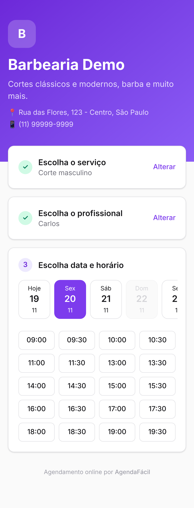

# AgendaFácil

SaaS de agendamento online para **barbearias, salões de beleza, clínicas de estética** e qualquer negócio que atende com horário marcado.

Cada estabelecimento ganha um painel de gestão e uma página pública de agendamento (ex.: `agendafacil.com/barbearia-do-joao`), onde os clientes marcam horário sozinhos, 24h por dia.

## Telas

| Painel do estabelecimento | Agendamento pelo cliente (celular) |
|---|---|
|  |  |

## Funcionalidades (MVP)

**Para o cliente final (página pública `/[slug]`)**
- Escolhe serviço → profissional (ou "sem preferência") → data → horário
- Só aparecem horários realmente livres (considera duração do serviço, intervalo de almoço, agenda de cada profissional, antecedência mínima)
- Página de confirmação com link para consultar/cancelar o agendamento

**Para o estabelecimento (`/painel`)**
- Agenda do dia com navegação por data e filtro por profissional
- Ações: confirmar, concluir, marcar falta, cancelar, reabrir
- Botão de WhatsApp com mensagem de confirmação pronta
- Agendamento manual (cliente que liga ou chega sem horário)
- Cadastro de serviços (duração e preço) e profissionais (quais serviços cada um faz)
- Horário de funcionamento por dia da semana, com intervalo
- Base de clientes criada automaticamente (visitas, último atendimento, total gasto)
- Regras: intervalo entre horários, antecedência mínima, até quantos dias à frente aceitar agendamentos

**Multiempresa (multi-tenant):** cada conta só enxerga os dados do próprio estabelecimento.

## Stack

- [Next.js](https://nextjs.org) (App Router, Server Actions) + React + TypeScript
- [Prisma](https://www.prisma.io) + PostgreSQL no [Supabase](https://supabase.com)
- Tailwind CSS
- Autenticação própria com sessão em cookie JWT (`jose`) e senhas com `bcryptjs`
- Testes com Vitest

## Como rodar

### 1. Crie o banco no Supabase
1. Crie uma conta em https://supabase.com e clique em **New project**.
2. Dê um nome, **anote a senha do banco** (Database Password) e escolha a região **South America (São Paulo)**.
3. Com o projeto criado, clique em **Connect** (no topo) → aba **ORMs** → **Prisma**.
4. Copie as duas linhas `DATABASE_URL` e `DIRECT_URL`.

### 2. Configure e rode o projeto
```bash
npm install
cp .env.example .env        # no Windows: copy .env.example .env
```
Abra o arquivo `.env`, cole as duas URLs do Supabase (trocando `[YOUR-PASSWORD]` pela senha do banco) e troque o `AUTH_SECRET` por um texto longo qualquer. Depois:
```bash
npm run db:migrate          # cria as tabelas no Supabase
npm run db:seed             # (opcional) cria a demo /barbearia-demo
npm run dev
```

Acesse http://localhost:3000. Login da demo: `demo@agendafacil.com` / `demo1234`.

As tabelas e os dados podem ser vistos no Supabase em **Table Editor**, ou com `npm run db:studio`.

Outros comandos: `npm test` (testes), `npm run typecheck`, `npm run build`.

**Alterando o banco:** depois de mudar `prisma/schema.prisma`, rode `npx prisma migrate dev --name descricao-da-mudanca` para gerar uma nova migration e `npm run db:migrate` para aplicá-la no Supabase.

## Estrutura

```
prisma/schema.prisma          Modelo de dados (Business, User, Service, Professional, WorkingHour, Client, Appointment)
src/lib/availability.ts       Motor de disponibilidade (funções puras, testadas)
src/lib/booking.ts            Cálculo de horários e criação de agendamento em transação (evita horário duplicado)
src/lib/auth.ts               Sessão / login
src/app/[slug]/               Página pública de agendamento
src/app/agendamento/[token]/  Consulta e cancelamento pelo cliente
src/app/painel/               Painel do estabelecimento
src/app/api/disponibilidade/  API de horários livres
```

Datas são guardadas como `YYYY-MM-DD` e horários como minutos desde 00:00, no fuso do estabelecimento (`APP_TIMEZONE`), evitando bugs de fuso horário.

## Deploy em produção (Vercel + Supabase)

1. Importe o repositório na [Vercel](https://vercel.com).
2. Em **Environment Variables**, cadastre `DATABASE_URL`, `DIRECT_URL`, `AUTH_SECRET` e `APP_TIMEZONE` (os mesmos valores do `.env`).
3. Faça o deploy. As tabelas já existem no Supabase se você rodou `npm run db:migrate`.

## Próximos passos (roadmap)

- [ ] **Lembretes automáticos no WhatsApp** (API oficial do WhatsApp Business / Z-API / Evolution API) — ex.: 24h e 2h antes
- [ ] Confirmação automática por resposta do cliente
- [ ] Horários e folgas por profissional + bloqueios de agenda (feriados, férias)
- [ ] Planos e cobrança recorrente do SaaS (Stripe / Asaas / Mercado Pago)
- [ ] Pagamento antecipado / sinal no agendamento (Pix)
- [ ] Relatórios: faturamento, serviços mais vendidos, taxa de faltas
- [ ] Vários usuários por estabelecimento (recepcionista, profissional com acesso só à própria agenda)
- [ ] Recuperação de senha por e-mail
- [ ] Logo e cores personalizadas na página pública
- [ ] Lista de espera e reagendamento pelo cliente
