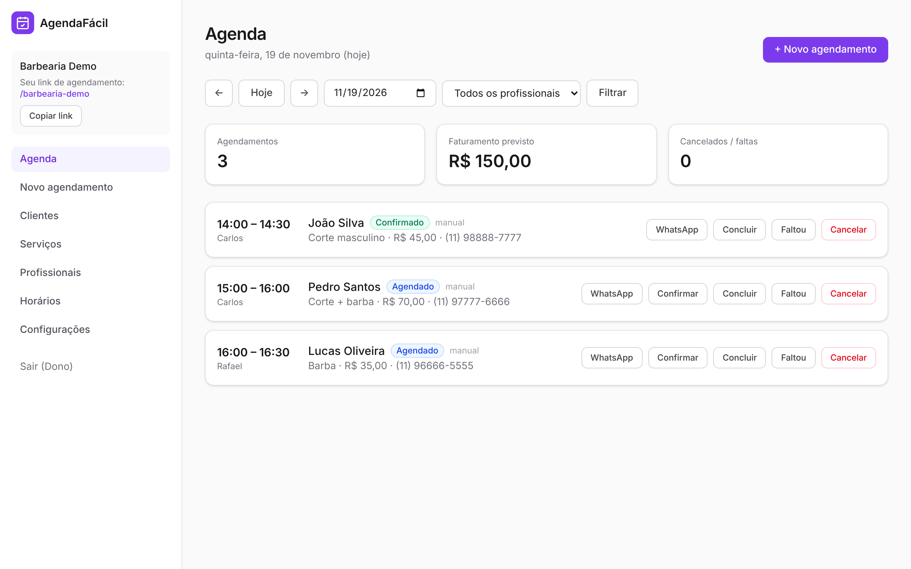

# HoraBoa

SaaS de agendamento online para **barbearias, salões de beleza, clínicas de estética** e qualquer negócio que atende com horário marcado.

Cada estabelecimento ganha um painel de gestão e uma página pública de agendamento (ex.: `horaboa.com/barbearia-do-joao`), onde os clientes marcam horário sozinhos, 24h por dia.

## Telas

| Painel do estabelecimento | Agendamento pelo cliente (celular) |
|---|---|
|  |  |

## Funcionalidades (MVP)

**Para o cliente final (página pública `/[slug]`)**
- Escolhe serviço → profissional (ou "sem preferência") → data → horário
- Só aparecem horários realmente livres (considera duração do serviço, intervalo de almoço, agenda de cada profissional, antecedência mínima)
- Página de confirmação com link para consultar/cancelar o agendamento

**Para o estabelecimento (`/painel`)**
- Agenda do dia com navegação por data e filtro por profissional
- Ações: confirmar, concluir, marcar falta, cancelar, reabrir
- Botão de WhatsApp com mensagem de confirmação pronta
- Agendamento manual (cliente que liga ou chega sem horário)
- Cadastro de serviços (duração e preço) e profissionais (quais serviços cada um faz)
- Horário de funcionamento por dia da semana, com intervalo
- Base de clientes criada automaticamente (visitas, último atendimento, total gasto)
- Regras: intervalo entre horários, antecedência mínima, até quantos dias à frente aceitar agendamentos

**Multiempresa (multi-tenant):** cada conta só enxerga os dados do próprio estabelecimento.

**Também incluído:** assinatura com teste grátis, pagamento por cartão (Stripe) e Pix, lembretes automáticos no WhatsApp, recuperação de senha por e-mail e páginas de LGPD — detalhes abaixo.

## Stack

- [Next.js](https://nextjs.org) (App Router, Server Actions) + React + TypeScript
- [Prisma](https://www.prisma.io) + PostgreSQL no [Supabase](https://supabase.com)
- Tailwind CSS
- Autenticação própria com sessão em cookie JWT (`jose`) e senhas com `bcryptjs`
- Testes com Vitest

## Como rodar

### 1. Crie o banco no Supabase
1. Crie uma conta em https://supabase.com e clique em **New project**.
2. Dê um nome, **anote a senha do banco** (Database Password) e escolha a região **South America (São Paulo)**.
3. Com o projeto criado, clique em **Connect** (no topo) → aba **ORMs** → **Prisma**.
4. Copie as duas linhas `DATABASE_URL` e `DIRECT_URL`.

### 2. Configure e rode o projeto
```bash
npm install
cp .env.example .env        # no Windows: copy .env.example .env
```
Abra o arquivo `.env`, cole as duas URLs do Supabase (trocando `[YOUR-PASSWORD]` pela senha do banco) e troque o `AUTH_SECRET` por um texto longo qualquer. Depois:
```bash
npm run db:migrate          # cria as tabelas no Supabase
npm run db:seed             # (opcional) cria a demo /barbearia-demo
npm run dev
```

Acesse http://localhost:3000. Login da demo: `demo@agendafacil.com` / `demo1234`.

As tabelas e os dados podem ser vistos no Supabase em **Table Editor**, ou com `npm run db:studio`.

Outros comandos: `npm test` (testes), `npm run typecheck`, `npm run build`.

**Alterando o banco:** depois de mudar `prisma/schema.prisma`, rode `npx prisma migrate dev --name descricao-da-mudanca` para gerar uma nova migration e `npm run db:migrate` para aplicá-la no Supabase.

## Estrutura

```
prisma/schema.prisma          Modelo de dados (Business, User, Service, Professional, WorkingHour, Client, Appointment)
src/lib/availability.ts       Motor de disponibilidade (funções puras, testadas)
src/lib/booking.ts            Cálculo de horários e criação de agendamento em transação (evita horário duplicado)
src/lib/auth.ts               Sessão / login
src/app/[slug]/               Página pública de agendamento
src/app/agendamento/[token]/  Consulta e cancelamento pelo cliente
src/app/painel/               Painel do estabelecimento
src/app/api/disponibilidade/  API de horários livres
```

Datas são guardadas como `YYYY-MM-DD` e horários como minutos desde 00:00, no fuso do estabelecimento (`APP_TIMEZONE`), evitando bugs de fuso horário.

## Deploy em produção (Vercel + Supabase)

1. Importe o repositório na [Vercel](https://vercel.com).
2. Em **Environment Variables**, cadastre `DATABASE_URL`, `DIRECT_URL`, `AUTH_SECRET` e `APP_TIMEZONE` (os mesmos valores do `.env`).
3. Faça o deploy. O build roda `prisma migrate deploy`, que cria/atualiza as tabelas no Supabase automaticamente.

## Assinatura e pagamentos

- **Teste grátis de 7 dias** em toda conta nova. Ao fim, o painel e a página pública ficam bloqueados até assinar (com 3 dias de tolerância após um vencimento).
- **Planos** (em `src/lib/plans.ts`): Mensal R$ 37,90 · Semestral R$ 197,40 (R$ 32,90/mês) · Anual R$ 334,80 (R$ 27,90/mês).
- **Cartão (Stripe):** checkout em modo assinatura, renovação automática, portal para trocar cartão/cancelar.
  1. Crie a conta em https://stripe.com e copie a *Secret key* para `STRIPE_SECRET_KEY`.
  2. Em *Developers → Webhooks*, adicione o endpoint `https://SEU-DOMINIO/api/webhooks/stripe` com os eventos
     `checkout.session.completed`, `customer.subscription.created`, `customer.subscription.updated`,
     `customer.subscription.deleted` e `invoice.paid`. Copie o *Signing secret* para `STRIPE_WEBHOOK_SECRET`.
  3. Em *Settings → Billing → Customer portal*, salve a configuração do portal (permitir cancelar e atualizar cartão).
- **Pix (Asaas):** assinatura Pix com renovação gerada pela Asaas e oferta de **Pix Automático** (o cliente autoriza no
  banco e as próximas cobranças são debitadas sozinhas). Código em `src/lib/pix/asaas.ts` e `src/lib/pix/asaas-billing.ts`
  ([documentação da Asaas](https://docs.asaas.com)).
  1. Na Asaas, em *Integrações → Chaves de API*, gere uma chave → `ASAAS_API_KEY` (chaves de Sandbox usam o Sandbox automaticamente).
  2. Em *Integrações → Webhooks*, crie um webhook para `https://SEU-DOMINIO/api/webhooks/asaas` com um **token de autenticação**
     (32+ caracteres) → `ASAAS_WEBHOOK_TOKEN`, e marque os eventos de **cobranças** e de **assinaturas**.
  3. Para o Pix Automático, a conta precisa estar elegível (conta e documentos aprovados, chave Pix cadastrada).
  - O 1º vencimento é no fim do teste grátis (pode pagar antes) e cada pagamento estende o plano. Ao assinar no cartão,
    a assinatura Pix é encerrada automaticamente.
- **Pix (SyncPay):** tela com QR code e copia e cola; liberação automática pelo webhook. Integração em `src/lib/pix/syncpay.ts`
  ([documentação da SyncPay](https://docs.syncpayments.com.br)):
  1. No painel da SyncPay, em *Developer → API*, crie uma chave com as permissões **Consulta** e **Venda**
     → `SYNCPAY_CLIENT_ID` e `SYNCPAY_CLIENT_SECRET`.
  2. Crie um webhook do evento **`transaction`** para `https://SEU-DOMINIO/api/webhooks/pix` e guarde o segredo (token)
     → `SYNCPAY_WEBHOOK_SECRET`. A assinatura `X-SyncPay-Signature` (HMAC-SHA256) é verificada em cada aviso.
  3. **IPs autorizados:** a SyncPay só aceita chamadas de IPs cadastrados, e a Vercel não tem IP fixo — combine com o
     suporte da SyncPay antes de ir para produção.
  4. A consulta de status é só contingência (`/api/cron/pagamentos`, a cada 15 min, no máximo 4 consultas por cobrança),
     pois a SyncPay limita a 5 consultas por transação.
  - Pix Automático (renovação automática) ainda não implementado.

## Lembretes no WhatsApp (Evolution API)

Cada estabelecimento conecta **o próprio WhatsApp** lendo um QR code no painel (menu *WhatsApp*). As mensagens
(confirmação ao agendar e lembretes 24h e 1h antes) saem do número do salão, e o texto pode ser personalizado
com as variáveis `{nome}`, `{estabelecimento}`, `{quando}`, `{servico}`, `{profissional}` e `{link}`.

Usa a [Evolution API](https://doc.evolution-api.com) (código aberto), instalada em um servidor próprio:

1. Crie o servidor — o jeito mais simples é o modelo pronto da Evolution API na [Railway](https://railway.com)
   (já inclui banco e Redis). Na Vercel não funciona, pois o WhatsApp precisa de um servidor ligado o tempo todo.
2. Copie o endereço público do servidor para `EVOLUTION_API_URL` e a chave global (`AUTHENTICATION_API_KEY`
   do servidor) para `EVOLUTION_API_KEY`.
3. Os lembretes rodam a cada **15 minutos** pelo *Vercel Cron* (configurado em `vercel.json`, plano Pro), que envia
   `Authorization: Bearer <CRON_SECRET>` automaticamente. Alternativa: um agendador externo (ex.: cron-job.org) chamando
   `GET https://SEU-DOMINIO/api/cron/lembretes?key=<CRON_SECRET>`. Rodar os dois ao mesmo tempo não duplica mensagens.

> ⚠️ A Evolution API não é oficial do WhatsApp: números podem ser bloqueados se usados para spam. O sistema só envia
> mensagens transacionais a quem agendou, o que reduz bastante o risco. Os Termos de Uso avisam o estabelecimento.

Se o WhatsApp de um salão desconectar, o envio falha, o sistema marca como desconectado e o painel mostra um aviso para reconectar.

## E-mail (recuperação de senha)

Usa a [Resend](https://resend.com) com o domínio `horaboa.com`: crie a conta, adicione o domínio em *Domains*,
cadastre os registros DNS indicados e copie a API key para `RESEND_API_KEY`.

## LGPD

Páginas `/termos` e `/privacidade`, aceite obrigatório no cadastro e aviso no agendamento do cliente.
Os textos são um ponto de partida — **revise com um advogado** antes de vender.

## Próximos passos (roadmap)

- [ ] Concluir a integração Pix da SyncPay e o Pix Automático (renovação automática no Pix)
- [ ] Aviso ao dono (WhatsApp/e-mail) antes do vencimento do plano no Pix
- [ ] Horários e folgas por profissional + bloqueios de agenda (feriados, férias)
- [ ] Vários usuários por estabelecimento (recepcionista, profissional com acesso só à própria agenda)
- [ ] Relatórios: faturamento, serviços mais vendidos, taxa de faltas
- [ ] Logo e cores personalizadas na página pública
- [ ] Lista de espera e reagendamento pelo cliente
- [ ] Monitoramento de erros (ex.: Sentry)
